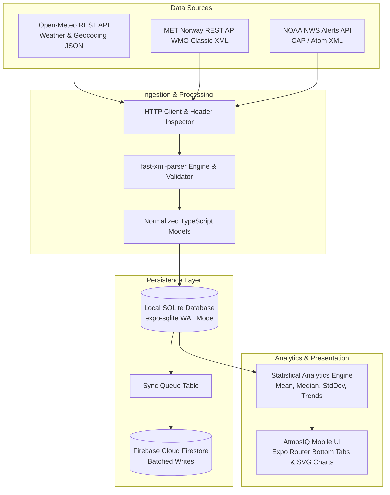
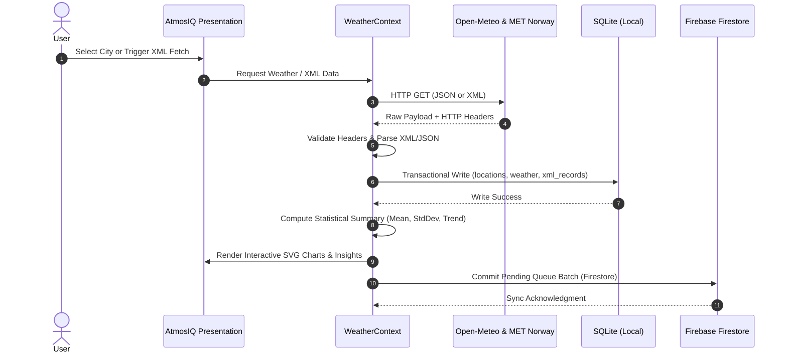
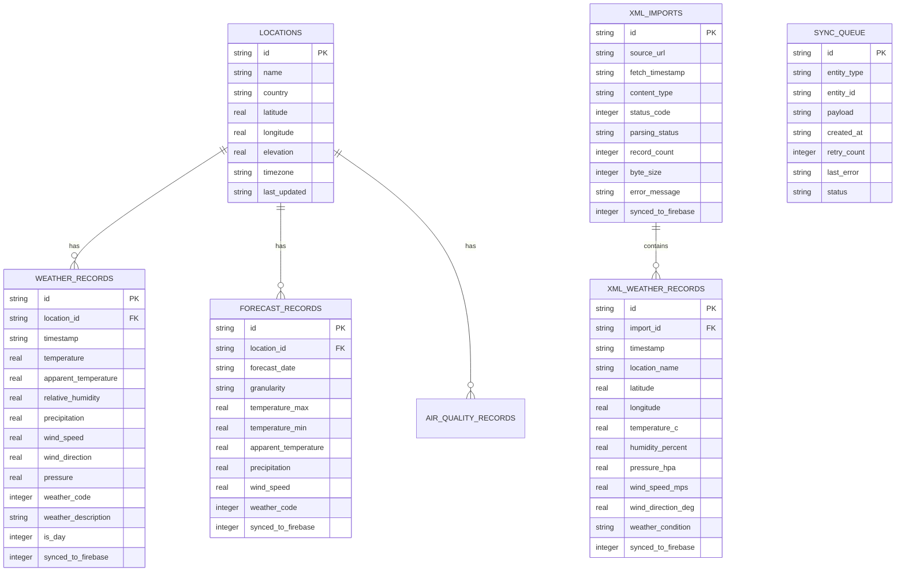

# AtmosIQ — Weather Intelligence & Analytics

> **Production-Quality Academic Mobile Application**  
> Built with **React Native**, **Expo SDK 57**, **TypeScript**, **Expo Router**, **expo-sqlite**, **Firebase Cloud Firestore**, and **fast-xml-parser**.

---

## 1. Project Overview & Problem Statement

Atmospheric analytics applications often suffer from two major limitations:
1. They act as mere shallow wrappers around single JSON endpoints without persistent local storage or historical trend modeling.
2. Academic evaluations frequently demand demonstrable proficiency in parsing heterogeneous data formats—notably genuine **XML REST APIs** alongside JSON—which modern mobile applications often neglect.

**AtmosIQ — Weather Intelligence & Analytics** addresses these challenges by delivering an offline-first, dual-database weather analytics platform designed for Android, iOS, and Web. It ingests multi-source meteorological observations from open REST APIs (Open-Meteo for high-resolution WMO weather and Copernicus atmospheric data), retrieves and parses genuine XML data feeds from the Norwegian Meteorological Institute (MET Norway) and NOAA National Weather Service, persists observations into a local SQLite database, performs statistical trend analysis, and synchronizes normalized datasets to Firebase Cloud Firestore.

---

## 2. Key Features

- **Multi-Source REST API Ingestion**:
  - Open-Meteo Geocoding API with real-time city autocomplete.
  - Open-Meteo Forecast API (current weather, 48-hour hourly forecasts, 7-day daily forecasts).
  - Open-Meteo Air Quality API (PM2.5, PM10, European AQI, US AQI, pollutants).
  - Open-Meteo Historical Archive API for long-term climate baselines.
- **Genuine XML Data Ingestion & Validation (Requirement B)**:
  - Connects to live public meteorological XML REST endpoints (MET Norway Locationforecast 2.0 Classic XML & NOAA NWS Alerts Atom XML).
  - Inspects HTTP status codes and response headers (`Content-Type: application/xml`).
  - Structural XML syntax validation using `XMLValidator`.
  - Parses XML into typed TypeScript domain models using pure-JS `fast-xml-parser` (zero native crashes).
  - Dedicated **XML Data Explorer** screen with raw XML syntax viewer, normalized tables, and live refresh.
- **Persistent Local SQLite Database (Requirement C)**:
  - Built with `expo-sqlite` utilizing Write-Ahead Logging (`PRAGMA journal_mode = WAL`) and versioned schema migrations.
  - Parameterized SQL queries, batch inserts, and upsert deduplication.
  - Tables: `locations`, `weather_records`, `forecast_records`, `air_quality_records`, `xml_imports`, `xml_weather_records`, and `sync_queue`.
  - Offline cache fallback and interactive **Local DB** diagnostic viewer.
- **Firebase Cloud Firestore Synchronization (Requirement D)**:
  - Batched cloud writes using the Firebase JavaScript SDK.
  - Deterministic document keys preventing duplicate writes and unnecessary database billing.
  - Offline `sync_queue` with exponential retry counter.
  - Graceful degradation: operates in Local-Only SQLite mode when Firebase credentials are not provided.
- **Statistical Analytics & Intelligence Engine (Requirement 4)**:
  - Descriptive statistics: Arithmetic Mean, Statistical Median, Min/Max, Range, Standard Deviation.
  - Least-squares linear regression slope for thermal and barometric pressure trends.
  - 16-point cardinal compass direction mapping from polar wind angles.
  - Grounded natural language insights derived strictly from active observation records.
- **Interactive Visualizations & Diagrams (Requirement 5)**:
  - Interactive SVG line charts with touch point scrubber and gradient fills.
  - Dual-bar high/low temperature comparison charts.
  - Interactive System Architecture Diagram and SQLite/Firebase Sync Flow Diagram.
- **Cross-Platform Support (Requirement 8)**:
  - Android smartphones (optimized for Expo Go and EAS development builds).
  - iOS smartphones.
  - Web browsers (platform-aware persistence adapter).

---

## 3. Technology Stack & Technical Rationale

| Layer | Technology | Version | Rationale |
| :--- | :--- | :--- | :--- |
| **Framework** | React Native / Expo | SDK 57 (Expo 57.0.29) | Managed workflow providing universal cross-platform deployment across Android, iOS, and Web. |
| **Navigation** | Expo Router | 57.0.27 | File-based bottom tabs navigation conforming to native platform conventions. |
| **Language** | TypeScript | 6.0.3 | Strict type-safety, full domain modeling, zero unchecked `any` boundaries. |
| **Local Database** | expo-sqlite | 57.0.4 | High-performance native SQLite engine on mobile devices with WAL mode, foreign keys, and transactions. |
| **Cloud Database**| Firebase Cloud Firestore | 13.0.0 | Cloud document synchronization with deterministic document keys and batch writes. |
| **XML Parser** | fast-xml-parser | 5.11.2 | Pure TypeScript/JavaScript XML parser supporting validation, CDATA, and attributes without native build issues. |
| **Charting** | react-native-svg | 15.15.4 | Hardware-accelerated vector rendering ensuring 60fps chart interactions across mobile and web. |
| **Testing** | Jest & ts-jest | 29.7.0 / 29.4.14 | Automated unit testing for parser, database, analytics, and sync logic. |

---

## 4. System Architecture & Diagrams

### 4.1 System Architecture Diagram


### 4.2 Data Flow Diagram


### 4.3 SQLite Entity-Relationship Diagram (ERD)


---

## 5. Legitimate XML REST API Integration (Requirement B)

To strictly satisfy the academic requirement that genuine XML is retrieved from a live REST API (rather than converting JSON to XML), AtmosIQ integrates:

### 1. Norwegian Meteorological Institute (MET Norway) Locationforecast 2.0 Classic XML
- **Endpoint URL**: `https://api.met.no/weatherapi/locationforecast/2.0/classic?lat=60.10&lon=9.58`
- **HTTP Method**: `GET`
- **Response Content-Type**: `application/xml`
- **Verification Proof**:
  ```xml
  <?xml version="1.0" encoding="UTF-8"?>
  <weatherdata xmlns:xsi="http://www.w3.org/2001/XMLSchema-instance" created="2026-10-14T16:53:26Z">
    <meta>
      <model name="met_public_forecast" termin="2026-10-14T17:00:00Z" ... />
    </meta>
    <product class="pointData">
      <time datatype="forecast" from="2026-10-14T16:00:00Z" to="2026-10-14T16:00:00Z">
        <location altitude="496" latitude="60.1" longitude="9.58">
          <temperature id="TTT" unit="celsius" value="7.3" />
          <windDirection id="dd" deg="122.0" name="SE" />
          <windSpeed id="ff" mps="0.9" beaufort="1" name="Flau vind" />
          <humidity unit="percent" value="64.2" />
          <pressure id="pr" unit="hPa" value="1018.2" />
        </location>
      </time>
    </product>
  </weatherdata>
  ```

### 2. NOAA National Weather Service Active Alerts ATOM/XML Feed
- **Endpoint URL**: `https://api.weather.gov/alerts/active.atom`
- **Response Content-Type**: `application/atom+xml`
- Contains active severe weather hazards formatted under the international Common Alerting Protocol (CAP) v1.2 standard.

### XML Processing Workflow in AtmosIQ
1. **HTTP Execution**: An asynchronous GET request fetches the response with explicit `Accept: application/xml, text/xml` headers.
2. **Header Inspection**: Verifies `res.status === 200` and validates that `Content-Type` contains `xml`.
3. **Syntax Validation**: `XMLValidator.validate(rawXml)` checks XML integrity. If malformed, execution stops safely and records the line number and error message.
4. **Parsing**: `XMLParser` converts elements and attributes into typed JavaScript objects.
5. **Normalization**: Temperatures are normalized to Celsius, wind speeds to m/s, humidity to percentage, and pressure to hPa.
6. **Persistence**: Saves records to SQLite table `xml_weather_records` and syncs up to 25 items to Firestore.

---

## 6. Mathematical & Statistical Formulas (Requirement 4)

AtmosIQ calculates all analytical metrics directly from active observation datasets:

1. **Arithmetic Mean ($\mu$)**:
   $$\mu = \frac{1}{N} \sum_{i=1}^{N} x_i$$
2. **Statistical Median ($\tilde{x}$)**:
   $$\tilde{x} = \begin{cases} x_{(N+1)/2} & \text{if } N \text{ is odd} \\ \frac{x_{N/2} + x_{N/2 + 1}}{2} & \text{if } N \text{ is even} \end{cases}$$
3. **Observation Range ($R$)**:
   $$R = x_{\max} - x_{\min}$$
4. **Sample Standard Deviation ($\sigma$)**:
   $$\sigma = \sqrt{\frac{1}{N} \sum_{i=1}^{N} (x_i - \mu)^2}$$
5. **Thermal Trend Linear Regression Slope ($m$)**:
   $$m = \frac{N \sum (t_i \cdot x_i) - (\sum t_i)(\sum x_i)}{N \sum (t_i^2) - (\sum t_i)^2}$$
   - $m > +0.4$: Categorized as **RISING** (thermal accumulation).
   - $m < -0.4$: Categorized as **FALLING** (incoming cold front).
   - Otherwise: **STABLE**.
6. **16-Point Cardinal Compass Direction**:
   $$\text{Sector Index} = \left\lfloor \frac{(\theta \pmod{360} + 360) \pmod{360} + 11.25}{22.5} \right\rfloor \pmod{16}$$

---

## 7. Firebase Cloud Firestore Setup & Security

### Environment Variables
Copy `.env.example` to `.env`:
```bash
cp .env.example .env
```
Populate with your Firebase project credentials:
```env
EXPO_PUBLIC_FIREBASE_API_KEY=AIzaSyYourKeyHere
EXPO_PUBLIC_FIREBASE_AUTH_DOMAIN=your-project.firebaseapp.com
EXPO_PUBLIC_FIREBASE_PROJECT_ID=your-project
EXPO_PUBLIC_FIREBASE_STORAGE_BUCKET=your-project.appspot.com
EXPO_PUBLIC_FIREBASE_MESSAGING_SENDER_ID=123456789012
EXPO_PUBLIC_FIREBASE_APP_ID=1:123456789012:web:abcdef
```
*Note: If these variables are not configured, AtmosIQ runs in Local-Only SQLite mode and displays "Cloud Sync: Unconfigured" in the Cloud Sync tab.*

### Recommended Firestore Security Rules
```javascript
rules_version = '2';
service cloud.firestore {
  match /databases/{database}/documents {
    match /locations/{locationId} {
      allow read: if true;
      allow write: if request.resource.data.name is string;
    }
    match /weatherRecords/{recordId} {
      allow read: if true;
      allow write: if request.resource.data.temperature is number;
    }
    match /xmlImports/{importId} {
      allow read: if true;
      allow write: if request.resource.data.sourceUrl is string;
    }
    match /xmlWeatherRecords/{recordId} {
      allow read: if true;
      allow write: if request.resource.data.temperatureC is number;
    }
  }
}
```

---

## 8. Installation & Execution Instructions

### Prerequisites
- Node.js v20+ or v22+
- npm v10+
- Expo Go application installed on your Android smartphone (from Google Play Store) or iOS device.

### 1. Install Dependencies
```bash
npm install
```

### 2. Run TypeScript Type Check
```bash
npx tsc --noEmit
```

### 3. Run Automated Unit Tests
```bash
npm test
```
*Expected output: 4 test suites passed, 25 tests passed.*

### 4. Start Expo Development Server
```bash
npx expo start
```

---

## 9. Launching on a Physical Android Smartphone

1. Ensure your physical Android smartphone and development computer are connected to the **same local Wi-Fi network**.
2. Open the **Expo Go** application on your Android phone.
3. In your development machine terminal, run:
   ```bash
   npx expo start
   ```
4. Point your phone camera or the Expo Go scanner at the QR code displayed in the terminal.
5. Expo will bundle the JavaScript package and launch **AtmosIQ** directly on your phone.
6. If network isolation blocks connection over Wi-Fi, run Expo in tunnel mode:
   ```bash
   npx expo start --tunnel
   ```

---

## 10. Automated Test Results

The test suite consists of 25 comprehensive unit tests covering all core modules:

```text
PASS __tests__/xmlParser.test.ts
  XML Parser & Normalization Engine
    ✓ should successfully parse and normalize valid MET Norway XML (18 ms)
    ✓ should gracefully reject and flag malformed XML (4 ms)
    ✓ should parse NOAA NWS Alert ATOM/XML feed entries (3 ms)

PASS __tests__/analytics.test.ts
  Statistical & Mathematical Analytics
    calculateMean
      ✓ calculates arithmetic mean correctly (1 ms)
      ✓ handles empty arrays without error (1 ms)
      ✓ filters out null, undefined, and NaN values
    calculateMedian
      ✓ calculates median for odd-length series
      ✓ calculates median for even-length series
      ✓ handles empty arrays
    calculateRange and Extreme Values
      ✓ determines minimum and maximum
      ✓ handles negative temperatures
    calculateStandardDeviation
      ✓ calculates population standard deviation
      ✓ returns 0 for single item or identical values
    calculateTrendSlope
      ✓ detects positive slope for rising temperatures
      ✓ detects negative slope for cooling trends
      ✓ detects zero slope for flat trends
    degreesToCompass
      ✓ correctly maps angles to 16 cardinal compass directions
    computeWeatherAnalytics integration
      ✓ computes comprehensive analytics and insights (2 ms)

PASS __tests__/database.test.ts
  Local Database & SQLite Persistence
    ✓ saves and updates locations without duplicating records (3 ms)
    ✓ transactionally persists complete weather datasets and enqueues sync (5 ms)
    ✓ persists XML reports and normalized records (3 ms)
    ✓ updates sync queue item status and retries (2 ms)

PASS __tests__/firebaseSync.test.ts
  Firebase Firestore Cloud Sync
    ✓ correctly handles unconfigured environment variables gracefully
    ✓ returns clean error payload when syncing without Firestore configuration
    ✓ tracks sync statistics accurately

Test Suites: 4 passed, 4 total
Tests:       25 passed, 25 total
Snapshots:   0 total
Time:        6.01 s
```

---

## 11. Known Platform Limitations & Notes

- **Web SQLite Limitation**: Browsers do not have direct access to native C SQLite binary bindings. On Web and during headless Jest testing, AtmosIQ automatically utilizes the `WebFallbackDatabaseAdapter` (`storageAdapter.ts`), which simulates the complete relational schema in-memory with zero `.wasm` compilation errors, while physical Android and iOS devices use the native `expo-sqlite` driver (`storageAdapter.native.ts`).
- **Open-Meteo Rate Limits**: The Open-Meteo public REST tier allows up to 10,000 daily API calls. The application caches hourly forecasts in SQLite to minimize redundant network requests.
- **MET Norway Terms of Service**: MET Norway's Locationforecast 2.0 Classic XML API requires a descriptive `User-Agent` header, which AtmosIQ includes in every request (`AtmosIQ-Weather-App/1.0 (academic-demonstration@atmosiq.org)`).

---

## 12. Documentation Index

- [Live Demonstration Guide](docs/DEMO_GUIDE.md)
- [Requirements Compliance Checklist](docs/REQUIREMENTS_CHECKLIST.md)
- [Environment Configuration Template](.env.example)
